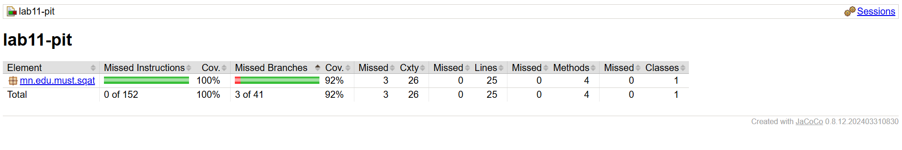
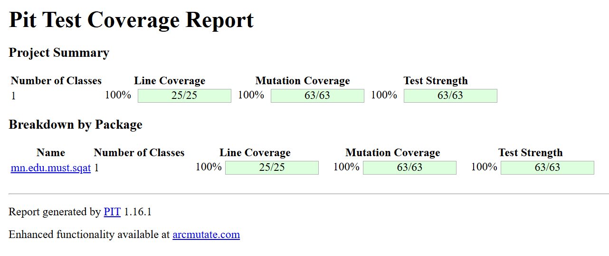

# Lab 11 — Mutation Testing (PIT)

- **Нэр:** З.Жаргалмаа
- **Оюутны код:** B232270005
- **Орчин** (бүтэн гаралт: `results/env.txt`):

```
openjdk version "17.0.21.0.3" 2026-10-24
OpenJDK Runtime Environment (build 17.0.21.0.3+1-1-24.04.1-Ubuntu)
Apache Maven 3.8.7
Java version: 17.0.21.0.3, vendor: Ubuntu
OS name: "linux", version: "6.6.87.2-microsoft-standard-wsl2" (WSL2, Ubuntu 24.04)
```

> `pom.xml`-д `maven.compiler.release` → `maven.compiler.source/target` болгож өөрчилсөн (maven-compiler-plugin 3.1 `release`-г дэмждэггүй). `src/main` **өөрчлөгдөөгүй**.

## Эхний хэмжилт

| Хэмжүүр | Үр дүн | Нотолгоо |
|---|---|---|
| JaCoCo Line | 25/25 (100%) | `results/jacoco-start.csv`, `img/jacoco-start.png` |
| JaCoCo Branch | 38/41 | `results/jacoco-start.csv` |
| PIT Mutation Coverage | **17/63 (27%)**, Test strength 27% | `results/pit-start.txt` |



**Зөрүүний тайлбар.** JaCoCo зөвхөн код *ажиллав уу* гэдгийг хэмждэг тул Line 100% гарсан ч тестүүд `assertNotNull`, `assertTrue(муж)` гэсэн сул шалгалттай байсан учир кодыг зөөлхөн өөрчлөхөд (`>=` → `>`, буцаах утгыг сольх) тест унахгүй, 63 мутантын 46 нь амьд үлдсэн. Өөрөөр хэлбэл хамралт нь тест *хэрэгжүүлсэн* кодыг хэлдэг бол mutation score нь тест алдааг *илрүүлж чадах эсэх*-ийг хэлдэг.

## A. Амьд мутантуудын ангилал

| Мөр | Мутаци (PIT-ийн тайлбар) | Ангилал | Үндэслэл | Арга хэмжээ |
|---|---|---|---|---|
| 20 | `changed conditional boundary` (`score < 0`, `score > 100`) | Тест дутуу | 0 ба 100 нь хүчинтэй оролт; `<`→`<=` болгож 0-д алдаа шиддэг болгосон ч тест мэдэхгүй. | `letterGrade(0.0)`, `letterGrade(100.0)` зааг тест |
| 23–26 | `changed conditional boundary`, `removed conditional` (`>= 90/80/70/60`) | Тест дутуу | Босго дээрх оноо өөр үсэг авах нь бодит зан төлөвийн өөрчлөлт. | 90/89.99, 80/79.99, 70/69.99, 60/59.99 тест |
| 23–27 | `replaced return value with ""` (`"A"`…`"F"`) | Тест дутуу | Буцаах үсгийг шалгадаггүй (`assertNotNull`) байсан. | `assertEquals` яг утгаар (B1) |
| 36 | `Changed switch default to be first case` | Тест дутуу | `"A"` case-ийн оронд default ажиллаж `total += 4` алгасагдаж голч өөрчлөгдөнө. | `gpa({95}) == 4.0` г.м. үсэг бүрийн тест |
| 37–40 | `Replaced double addition with subtraction` (`total += 4/3/2/1`) | Тест дутуу | Нийлбэр буруу бодогдоно, гэхдээ муж шалгадаг тест үүнийг мэдэхгүй. | Голчийн яг утга (3.5, 1.5, …) |
| 44 | `replaced double return with 0.0d`, `Replaced division with multiplication` | Тест дутуу | Голч буруу буцаах нь шууд зан төлөвийн алдаа. | `assertEquals(3.5, …, 1e-6)` |
| 48 | `changed conditional boundary` (`gpa < 0`, `gpa > 4`), `removed conditional` (`credits < 0`) | Тест дутуу | `gpa=0`, `gpa=4`, `credits=0` хүчинтэй утгууд; нөхцөл арилбал буруу оролт өнгөрнө. | `scholarship(0.0,0)`, `(4.0,0)`, `(-0.1,…)`, `(4.1,…)`, `(…,-1)` |
| 51 | `removed conditional` (`if (hasViolation)`) | Тест дутуу | Сахилгын зөрчилтэй оюутан тэтгэлэг авах/авахгүй байх нь бодит зан төлөв. | `scholarship(4.0, 20, true) == 0` яг утгаар |
| 52 | `changed conditional boundary`, `removed conditional`, `replaced int return with 0` (`gpa >= 3.8 && credits >= 15`, `return 100`) | Тест дутуу | 3.8/15 зааг дээр 100 → 70 болох нь бодит өөрчлөлт. | `(3.8,15)=100`, `(3.8,14)=70`, `(2.9,15)=0` |
| 53 | ижил 3 төрөл (`gpa >= 3.4 && credits >= 12`, `return 70`) | Тест дутуу | 3.4/12 зааг дээр 70 → 50 болно. | `(3.4,12)=70`, `(3.4,11)=50` |
| 54 | ижил 3 төрөл (`gpa >= 3.0`, `return 50`) | Тест дутуу | 3.0 дээр 50 → 0 болно. | `(3.0,10)=50`, `(2.9,…)=0` |

> Equivalent гэж ангилсан мутант **байхгүй**: 46 амьд мутантын бүгд бодит зан төлөвийг өөрчилдөг, B2-ийн дараа бүгд алагдсан.

## B. Тестийг хүчтэй болгох — гурван хэмжилт

| Алхам | Commit | Mutation Coverage | Test strength | Файл |
|---|---|---|---|---|
| Эхлэл | `Эхний хэмжилт` | 17/63 (27%) | 27% | `results/pit-start.txt` |
| B1: assertion → яг утга | `B1: …` | **45/63 (71%)** | 71% | `results/pit-B1.txt` |
| B2: зааг утгын тест | `B2: …` | **63/63 (100%)** | 100% | `results/pit-B2.txt` |

- **B1** — `assertNotNull`, `assertTrue(муж)`-г `assertEquals(яг утга)` болгосон (letterGrade, gpa, scholarship).
- **B2** — нэмсэн тестүүд: `letterGrade_exactBoundaries` (0, 59.99, 60, 69.99, 70, 79.99, 80, 89.99, 90, 100), `gpa_singleGrade_eachLetter` (A/B/C/D/F бүр), `scholarship_boundaries_and_tiers` (3.8/15, 3.4/12, 3.0, gpa 0 ба 4, credits 0), `scholarship_invalidInputs_throw`-д `gpa=-0.1`.



Үлдсэн амьд мутант: **байхгүй** (63/63 алагдсан, Test strength 100%, `results/pit-B2.txt`). Иймд equivalent гэж үндэслэх мутант шаардлагагүй.

## C. Гар мутант (PIT-гүйгээр)

`scholarship()`-ийн 52-р мөрийг `gpa >= 3.8` → `gpa > 3.8` болгож `mvn test` ажиллуулсан (`results/mvn-test-manual-mutant.txt`):

- **Унасан тест:** `ScholarshipCalculatorTest.scholarship_boundaries_and_tiers` (`ScholarshipCalculatorTest.java:95`, assertion нь 98-р мөр).
- **Алдааны мөр:** `AssertionFailedError: expected: <100> but was: <70>`.
- `Tests run: 9, Failures: 1` → мутант **алагдсан**. Дараа нь `git restore src/main`-ээр буцаасан (мутацитай код commit хийгээгүй).

**Өөрийн equivalent мутант.** `gpa()`-ийн 40-р мөрийн `case "D": total += 1; break;` дахь `break`-ийг устгав. Тэгэхэд `"D"` case дараагийн `default: break;` руу унадаг боловч default нь юу ч хийдэггүй тул `total` ба буцаах утга бүх оролтод яг ижил хэвээр. Зан төлөв өөрчлөгдөөгүй учир ямар ч тест үүнийг ялгаж чадахгүй (`mvn test` бүгд амжилттай: `results/mvn-test-equivalent-mutant.txt`).

## Дүгнэлт

Line/Branch coverage нь тест кодын аль хэсгийг *ажиллуулсныг* хэмждэг бол mutation score нь тест кодын зан төлөвийн өөрчлөлтийг *илрүүлж чадахыг* хэмждэг. Манай starter багц Line 100% байсан ч mutation score ердөө 27% байсан нь хамралт өндөр байхад тест сул байж болохыг харуулсан. Assertion-уудыг яг утгаар сольсноор (B1) score 71% болж, зааг утгын тест нэмсний дараа (B2) 100% хүрсэн — өөрөөр хэлбэл `>=`/`>` төрлийн алдаа зааг утга шалгахгүйгээр баригдахгүй. Гар мутант (`>= 3.8` → `> 3.8`) B2-ын `(3.8, 15)` тестээр шууд баригдсан нь PIT-ийн автомат мутацийн санааг нотолсон. AI-аар тест бичүүлэхэд ихэвчлэн бүх салааг дайрсан, харагдах байдлаар "бүрэн" багц гарах боловч зааг утга болон буцаах утгын нарийн шалгалт орхигдох нь элбэг тул хамралтын тоо дангаараа итгэлтэй баталгаа биш. Тиймээс AI-ийн бичсэн тестийг mutation score-оор шалгаж, амьд үлдсэн мутантуудыг буцаан AI-д өгч нөхүүлэх хэрэгтэй. Equivalent мутантууд score-ийг 100%-д хүргэхгүй болгодог тул тэдгээрийг хүн гараар шинжилж ялгах ёстой.
